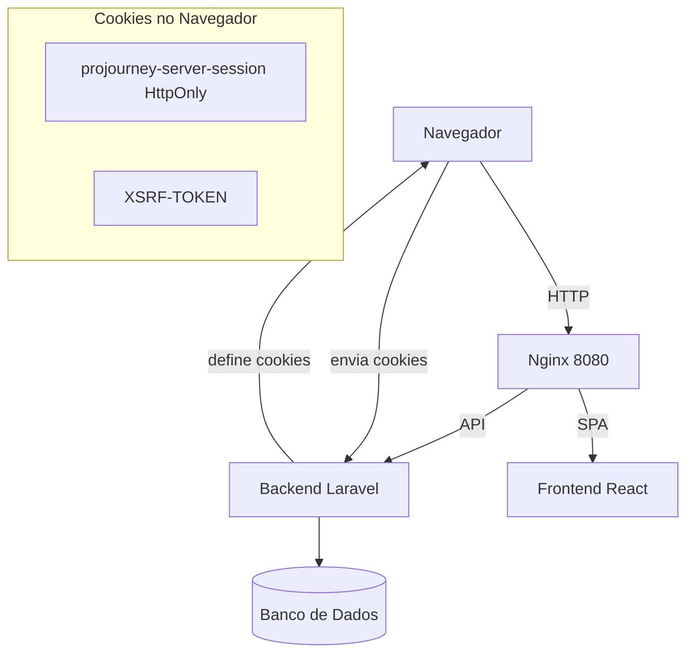
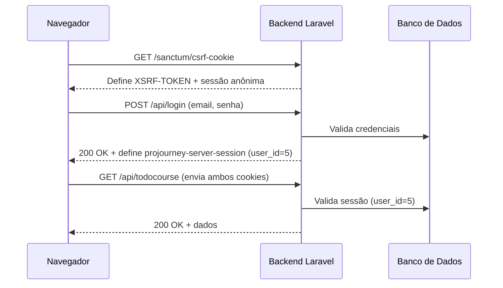
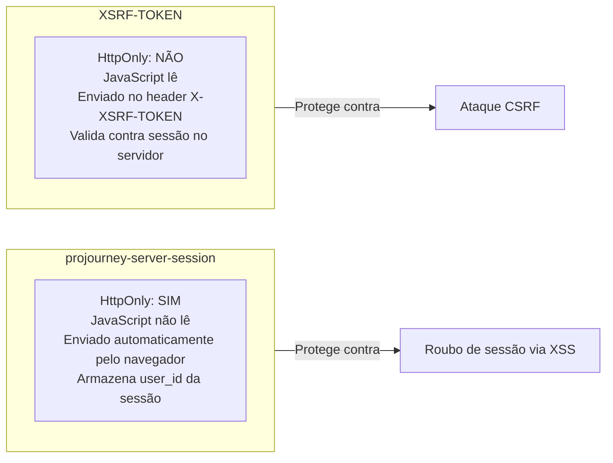
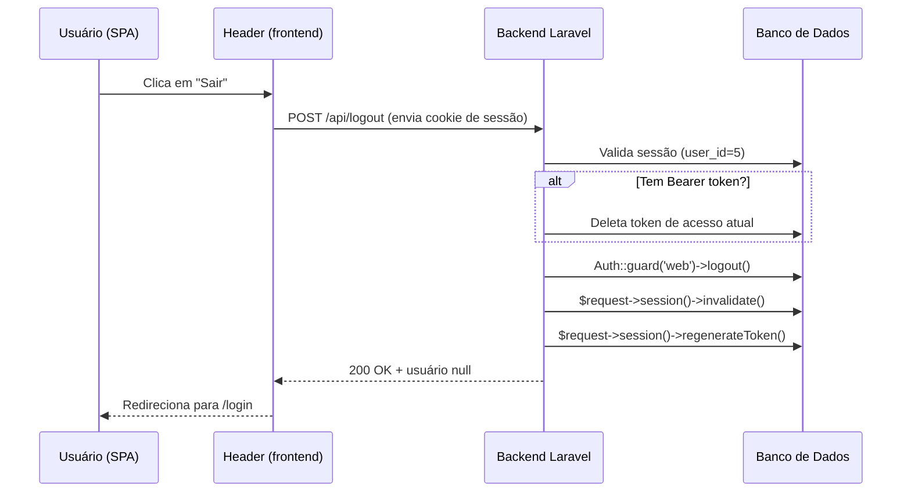
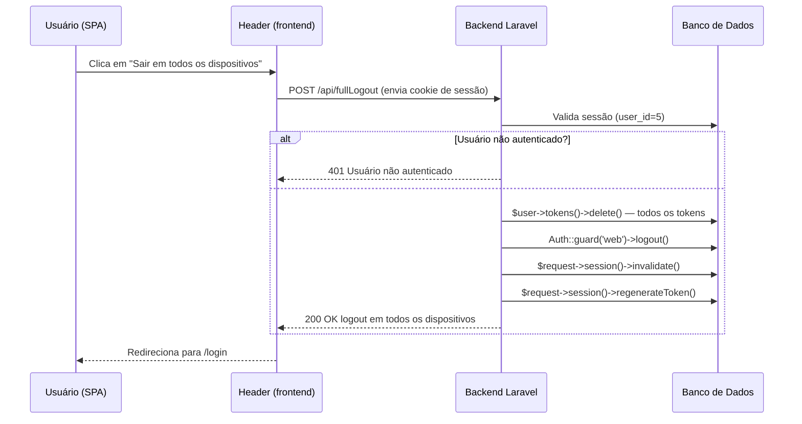

# Método de Autenticação — HttpOnly + X-XSRF-TOKEN

## Índice

- [Visão Geral](#visão-geral)
- [Conceitos Fundamentais](#conceitos-fundamentais)
- [Componentes Envolvidos](#componentes-envolvidos)
- [Configuração de Cookies](#configuração-de-cookies)
- [Middlewares](#middlewares)
- [Fluxo de Autenticação — Funcionando](#fluxo-de-autenticação---funcionando)
- [Diferença entre os Dois Cookies](#diferença-entre-os-dois-cookies)
- [Validação de CSRF](#validação-de-csrf)
- [Logout e FullLogout](#logout-e-fulllogout)
- [Segurança e Considerações](#segurança-e-considerações)
- [Referências nos Arquivos do Projeto](#referências-nos-arquivos-do-projeto)
- [Navegação na Documentação](#navegação-na-documentação)

---


## Diagrama geral do sistema





---

## Visão Geral

Esta documentação descreve como o Laravel implementa a autenticação do frontend React (SPA) usando:

- **HttpOnly cookie** para a sessão de autenticação (`projourney-server-session`);
- **X-XSRF-TOKEN** como token CSRF enviado no header das requisições.

A combinação garante que:

- O token CSRF esteja disponível para o frontend (JavaScript) ler e enviar;
- A sessão de usuário permaneça protegida contra acesso via JavaScript (HttpOnly);
- O servidor valide o token CSRF sem depender de decodificação complexa;
- Requisições autenticadas (POST, PUT, DELETE) sejam rejeitadas quando o token CSRF estiver ausente ou incorreto.

---

## Conceitos Fundamentais

### HttpOnly (cookie `projourney-server-session`)

O cookie `projourney-server-session` é marcado como **HttpOnly**. Isso significa que o navegador **não permite que JavaScript leia ou escreva** esse cookie. Ele é enviado automaticamente pelo navegador em cada requisição ao mesmo domínio, mas o código React não consegue acessar seu valor.

**Por que foi implementado:** protege contra roubo de sessão via XSS (Cross-Site Scripting). Se um atacante conseguir executar JavaScript malicioso no navegador do usuário, ele não conseguirá ler o cookie de sessão e, portanto, não conseguirá se passar pelo usuário logado.

### XSRF-TOKEN e o header `X-XSRF-TOKEN`

O cookie `XSRF-TOKEN` **não é HttpOnly** — o JavaScript pode lê-lo. O frontend envia esse valor no header `X-XSRF-TOKEN` a cada requisição que muda dados (POST, PUT, DELETE). O Laravel compara o valor do header com o valor armazenado na sessão do servidor.

**Por que foi implementado:** protege contra ataques CSRF (Cross-Site Request Forgery). Nesses ataques, um site malicioso faz o navegador do usuário enviar requisições para o Projourney usando a sessão logada. Como o site malicioso não consegue ler o cookie `XSRF-TOKEN` (ele pertence a outro domínio), não consegue preencher o header `X-XSRF-TOKEN`, e o Laravel rejeita a requisição.

### Sessão com expiração por tempo determinado

A sessão Laravel tem um tempo de vida configurado (prazo determinado). Após esse período, o servidor invalida a sessão e o usuário precisa fazer login novamente. Isso limita o tempo em que um cookie de sessão roubado (se houver) poderia ser usado.

---

## Componentes Envolvidos

| Componente | Função | Local |
|------------|--------|-------|
| **Session Cookie (`projourney-server-session`)** | Contém o identificador da sessão e dados do usuário (user_id). | Configuração de sessão (`config/session.php`) |
| **XSRF-TOKEN** | Token CSRF em texto plano, usado para validar a origem da requisição. | Cookie `XSRF-TOKEN` (não HttpOnly) |
| **Middleware `EncryptCookiesExceptCsrf`** | Garante que o cookie de sessão seja criptografado, mas exclui o `XSRF-TOKEN` da criptografia. | `app/Http/Middleware/EncryptCookiesExceptCsrf.php` |
| **Middleware `VerifyCsrfTokenPlain`** | Valida o token CSRF comparando o valor da sessão com o token enviado no header `X-XSRF-TOKEN` (ou campo `_token`). | `app/Http/Middleware/VerifyCsrfTokenPlain.php` |
| **Middleware `EnsureFrontendRequestsAreStateful`** | Habilita o middleware de sessão para requisições da SPA (Inertia/React) via Sanctum. | `config/sanctum.php` + `bootstrap/app.php` |

---

## Configuração de Cookies

### Sessão (HttpOnly)

```php
// config/session.php
'session' => [
    // ...
    'http_only' => env('SESSION_HTTP_ONLY', true), // garante que o cookie não é acessível via JS
    'same_site' => env('SESSION_SAME_SITE', 'lax'), // protege contra CSRF cross-site
],
```

### XSRF Token (não HttpOnly)

```php
// config/session.php
'except' => [
    'XSRF-TOKEN', // cookie XSRF-TOKEN não é criptografado
],
```

### Middleware de Criptografia de Cookies

```php
// app/Http/Middleware/EncryptCookiesExceptCsrf.php
protected $except = [
    'appearance',
    'sidebar_state',
    'XSRF-TOKEN', // token CSRF permanece legível
];
```

---

## Fluxo de Autenticação — Funcionando



O fluxo funciona da seguinte forma:

1. **`GET /sanctum/csrf-cookie`** — retorna o cookie `XSRF-TOKEN` e inicia uma sessão anônima.
2. **`POST /api/login`** — autentica o usuário, preenche `user_id` na sessão existente e define o cookie `projourney-server-session` (HttpOnly).
3. **Requisições autenticadas** (`GET /api/todocourse`, `POST /api/logout`, `POST /api/fullLogout`, etc.) — enviam os dois cookies; o Laravel reconhece a sessão logada e retorna **200**.

O middleware `EnsureFrontendRequestsAreStateful` do Sanctum trata cada requisição da API como stateful (baseada em sessão de cookie), sem criar sessões novas sozinho.

---

## Diferença entre os Dois Cookies



| Aspecto | `projourney-server-session` | `XSRF-TOKEN` |
|---------|----------------------------|--------------|
| HttpOnly | Sim | Não |
| Acessível via JavaScript | Não | Sim |
| Envio automático pelo navegador | Sim (cookies) | Sim (cookies) |
| Envio no header | Não | Sim (`X-XSRF-TOKEN`) |
| Protege contra | XSS (roubo de sessão) | CSRF (requisição forjada) |

---

## Validação de CSRF

O middleware `VerifyCsrfTokenPlain` (estendendo `PreventRequestForgery`) compara:

- **Token da sessão** (`$request->session()->token()`)
- **Token enviado no header** (`$request->header('X-XSRF-TOKEN')`)

A comparação é feita com `hash_equals` para evitar ataques de timing.

Se os tokens não coincidirem, lança-se `TokenMismatchException`, abortando a requisição.

O frontend (React) lê o valor do cookie `XSRF-TOKEN` via `document.cookie` e, em cada requisição `fetch`/`axios`, inclui o token no header `X-XSRF-TOKEN`.

---

## Logout e FullLogout

O usuário comum do frontend React (`/spa`) encontra essas duas opções no menu do cabeçalho (`Header`):

| Botão na UI | Rota chamada | O que faz para o usuário |
|-------------|-------------|--------------------------|
| **Sair** | `POST /api/logout` | Encerra a sessão do dispositivo atual. O usuário volta para a tela de login. |
| **Sair em todos os dispositivos** | `POST /api/fullLogout` | Encerra a sessão e deleta todos os tokens do usuário, deslogando-o de qualquer outro navegador ou dispositivo onde esteja logado. |

### `POST /api/logout` — `AuthController::logout()`



**O que faz:**
- Se o usuário tiver um token Bearer (CLI/Mobile), deleta o token de acesso atual.
- Se houver sessão (SPA/browser): faz logout do guard `web`, invalida a sessão e regenera o token CSRF.
- O frontend remove `loggedUser` do `localStorage` e redireciona para `/login`.
- Retorna 200 com `user: null`.

### `POST /api/fullLogout` — `AuthController::fullLogout()`



**O que faz:**
- Requer autenticação (retorna 401 se não houver usuário logado).
- Deleta **todos** os tokens do usuário (`$user->tokens()->delete()`), não apenas o atual — desloga de todos os dispositivos.
- Se houver sessão: faz logout do guard `web`, invalida a sessão e regenera o token CSRF.
- O frontend remove `loggedUser` do `localStorage` e redireciona para `/login`.
- Retorna 200 com mensagem de logout realizado em todos os dispositivos.

### Diferença entre logout e fullLogout

| Aspecto | `logout` ("Sair") | `fullLogout` ("Sair em todos os dispositivos") |
|---------|-------------------|-----------------------------------------------|
| Exige autenticação | Não (funciona com sessão ou token) | Sim (retorna 401 se não autenticado) |
| Tokens deletados | Apenas o token atual (se Bearer) | Todos os tokens do usuário |
| Sessão | Invalidada e regenerada | Invalidada e regenerada |
| Caso de uso | Logout normal (dispositivo atual) | Logout em todos os dispositivos |

---

## Segurança e Considerações

- **HttpOnly** impede que JavaScript leia o cookie de sessão, mitigando XSS que tenta roubar a sessão.
- **XSRF-TOKEN** em texto plano permite que o frontend inclua o token em requisições customizadas (headers ou parâmetros), essencial para APIs SPA.
- **SameSite=Lax** impede que requisições cross-site (ex.: formulário de outro domínio) enviem o cookie de sessão, reduzindo vetores de CSRF.
- **Exclusão do XSRF-TOKEN da criptografia** garante que o token seja sempre legível, sem sobrecarga de criptografia.
- **HTTPS obrigatório** (configuração `SESSION_SECURE_COOKIE`) assegura que ambos os cookies só sejam enviados via conexão segura.

---

## Referências nos Arquivos do Projeto

- **config/session.php** — define `http_only`, `same_site` e a lista de cookies a serem excluídos da criptografia.
- **app/Http/Middleware/EncryptCookiesExceptCsrf.php** — exclui `XSRF-TOKEN` da criptografia.
- **app/Http/Middleware/VerifyCsrfTokenPlain.php** — implementa a verificação de CSRF baseada em token em texto plano.
- **bootstrap/app.php** — registra o middleware `EnsureFrontendRequestsAreStateful` para que a sessão seja mantida nas requisições da SPA.
- **app/Http/Controllers/Api/V1/AuthController.php** — contém os métodos `login()`, `logout()` e `fullLogout()`.
- **frontend_react/src/lib/api.ts** — `apiFetch` injeta automaticamente o `X-XSRF-TOKEN` do cookie; `initCsrf()` obtém o cookie CSRF.
- **frontend_react/src/components/layout/header.tsx** — expõe os botões "Sair" e "Sair em todos os dispositivos" no menu do cabeçalho.


---

## Navegação na Documentação

| Documento | Link |
|-----------|------|
| [README.md (Principal)](../README.md) | Visão geral do projeto |
| [database.md](./database.md) | Schema do banco de dados |
| [backlog.md](./backlog.md) | Histórico de tarefas |
| [gate-policy-admin-authorization.md](./gate-policy-admin-authorization.md) | Autorização baseada em roles |
| [inertia-react-stack.md](./inertia-react-stack.md) | Arquitetura frontend com Inertia.js |
| [populate-database-legacy-backup.md](./populate-database-legacy-backup.md) | Importação de dados do legado |

---

*Documento atualizado em 2026-11-01 — descreve o método de autenticação Sanctum SPA (HttpOnly + X-XSRF-TOKEN) do ProJourney.*
